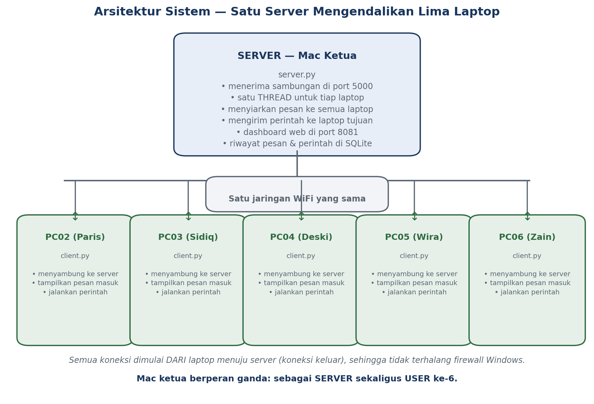

# Arsitektur Sistem

Satu server di tengah, lima laptop mengelilinginya. Semua sambungan **dimulai
dari laptop menuju server** (koneksi keluar), bukan sebaliknya.

## Komponen

| Komponen | Berjalan di | Peran | Port |
|---|---|---|---|
| `server.py` | Laptop ketua (Mac) | Menerima sambungan, meneruskan pesan, mengirim perintah | 5000 (TCP) |
| Dashboard (`static/index.html`) | Dilayani server | Memantau dan mengirim perintah lewat peramban | 8081 (HTTP) |
| `client.py` | Tiap laptop anggota | Menerima pesan dan menjalankan perintah | — (menyambung keluar) |
| SQLite (`data/chat.db`) | Laptop server | Riwayat pesan, perintah, dan kejadian | — |

## Keputusan Teknis

| Keputusan | Alasan |
|---|---|
| Satu **thread per klien** di server | Satu laptop yang lambat tidak menahan laptop lain. Kalau semua klien dilayani dalam satu urutan, satu yang tersendat membuat semuanya menunggu. |
| Pesan berbentuk **JSON satu baris** | TCP adalah aliran byte, bukan kumpulan pesan. Tanpa pemisah yang jelas, dua pesan bisa tercampur. |
| Klien dikenali dari **hostname**, bukan IP | Alamat IP berubah setiap kali laptop menyambung ulang ke WiFi; hostname tetap. IP tetap dipakai, tetapi hanya untuk sambungan pertama. |
| Koneksi dimulai **dari laptop ke server** | Koneksi keluar tidak diblokir firewall Windows. Kalau server yang menyambung ke laptop, tiap laptop harus mengubah pengaturan firewall lebih dahulu. |
| Perintah dibatasi **daftar putih** | Server tidak boleh dapat menjalankan perintah bebas di laptop orang lain; perintah yang diketahui saja yang bisa dicatat dan dipertanggungjawabkan. |
| **Perintah daya ditolak di macOS** secara bawaan | Mac ketua dipakai sebagai server. Tanpa pengaman ini, satu perintah yang salah kirim bisa mematikan komputer yang sedang dipakai presentasi. |
| Dashboard memakai **HTTP**, bukan socket | Dashboard hanya perlu membaca keadaan sesekali; tidak perlu sambungan yang terus terbuka. |

## Alur Satu Pesan

1. Laptop pengirim mengetik pesan; `client.py` mengirimnya ke server sebagai satu baris JSON.
2. Server menerima, menyimpannya ke tabel `pesan`, lalu memeriksa tujuan.
   - Tujuan `"semua"` → diteruskan ke seluruh laptop **kecuali pengirimnya**.
   - Tujuan satu hostname → hanya dikirim ke laptop itu. Kalau laptopnya tidak
     tersambung, pengirim langsung menerima pemberitahuan.
3. Server mengirim laporan `terkirim` kepada pengirim, berisi jumlah laptop yang menerima.
4. Setiap laptop penerima menampilkan pesan di layarnya.

## Alur Satu Perintah

1. Dashboard mengirim permintaan HTTP ke `/api/perintah?sasaran=X&aksi=Y`.
2. Server memeriksa apakah `aksi` ada di daftar putih. Kalau tidak, ditolak.
3. Perintah dicatat ke tabel `perintah` (sebelum dikirim, bukan sesudah — supaya
   tetap tercatat walaupun laptopnya keburu mati).
4. Perintah dikirim ke laptop yang dituju.
5. Laptop menjalankannya, lalu mengirim balik laporan hasil.
6. Server mencatat laporan itu ke baris tabel yang sama, sehingga di dashboard
   terlihat pasangan perintah dan hasilnya.

## Titik Kegagalan yang Diketahui

| Kelemahan | Akibatnya | Kemungkinan perbaikan |
|---|---|---|
| Server adalah satu-satunya titik pusat | Server mati = seluruh sistem berhenti | Menyiapkan server cadangan, atau memakai beberapa server yang saling mengetahui |
| Pesan tidak dienkripsi | Pesan bisa dibaca pihak lain di jaringan yang sama | Menambahkan TLS atau enkripsi pada isi pesan |
| SQLite tidak tahan akses bersamaan yang banyak | Penulisan bisa antre saat klien sangat banyak | Berpindah ke basis data yang melayani penulisan bersamaan |
| Percobaan ulang sambungan belum ada | Kalau WiFi sempat putus, agent harus dijalankan ulang | Menambahkan percobaan sambung ulang otomatis |

Kelemahan-kelemahan ini dicatat terbuka, bukan disembunyikan, karena menjadi bahan
diskusi lanjutan saat presentasi.

## Hasil Pengujian

Bukti bahwa rancangan ini bekerja ada di [`pengujian.md`](pengujian.md).
